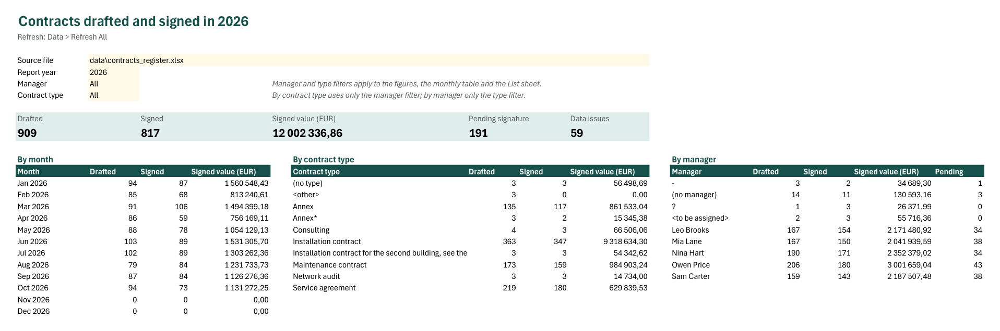
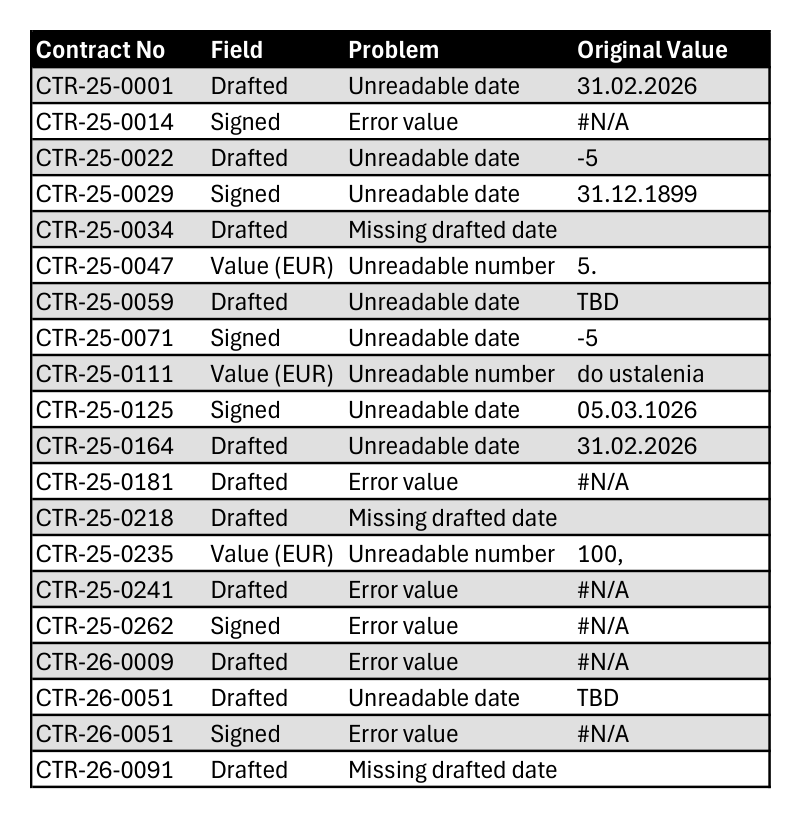
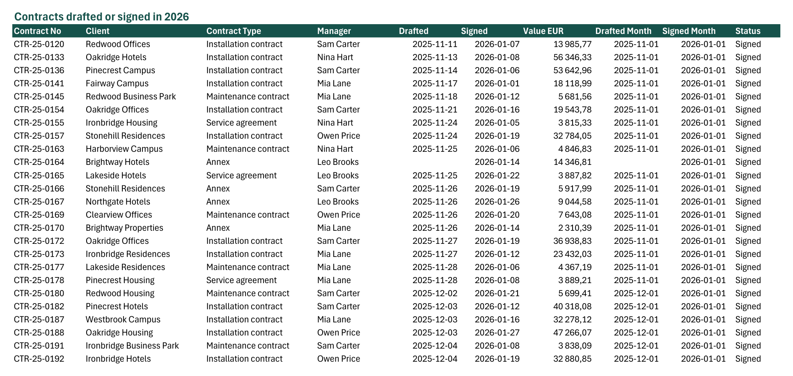

# Contracts Report (Power Query)

One click on **Data > Refresh All** reads the office's contracts register and shows the contracts drafted and signed in the report year: totals, by month, by contract type, by manager, and a list you can filter. The register is a workbook that people edit by hand, so the refresh is built to survive renamed columns, title rows, a table moved to another sheet, dates typed as text and `#N/A` cells left by lookups. Every cell it cannot read goes to a Data Issues sheet, and the refresh still runs.

Excel without macros: Power Query (M) plus dynamic-array formulas (LET, MAP, LAMBDA, FILTER, SORT, UNIQUE, SEQUENCE). All data is generated demo data.



## The problem

A company that installs security systems and Wi-Fi in buildings keeps its contracts register in Excel. Management wants to know how many contracts were drafted and signed this year, what the signed contracts are worth, and which ones are still waiting for a signature. The register is not a clean database:

- someone renames `Contract Type` to `Rodzaj umowy`, or puts a line break inside a header
- an instruction sheet and title rows appear in front of the table
- dates arrive as real dates, as `05.03.2026`, `2026-03-05` or `05/03/2026` text, or as serial numbers
- amounts arrive as `12 500,00` or `12,500.00` text
- `#N/A` from a broken lookup, `TBD`, `brak` or `31.02.2026` sit where a date should be

A report built on fixed column positions breaks on the first of these, or worse, shows wrong totals without any warning.

## What the refresh does

1. **Finds the table.** It looks at the sheets in workbook order and takes the first one with a header row in its first 15 rows. A header row is a row that names at least 4 of the 7 known columns.
2. **Maps the columns by name, not by position.** Header names are compared after normalising: lower case, Polish and German letters folded to ASCII, everything except letters and digits removed. `DATA` + line break + `PODPISANIA` and `Data podpisania` give the same key. Other columns are ignored.
3. **Reads every cell with fixed rules**, independent of the Windows regional settings (see below).
4. **Keeps every row.** A cell it cannot read becomes empty and gets a row on the Data Issues sheet. The contract still counts, so a typo never makes a contract vanish from the totals.
5. **Stops with a clear message** when the file has no such table or misses a required column, for example `Required columns not found in C:\...\register.xlsx (sheet "Umowy 2026"): Drafted. Check the header names against the HeaderMap query.`

On the demo register (1,200 contracts) Refresh All takes about 4 seconds, about 12 seconds for the first refresh after opening the workbook. It loads all 1,200 contracts and lists 59 problem cells.

### Source-file problems it handles

| Problem in the register | Example | What the refresh does |
|---|---|---|
| Renamed or translated headers | `Rodzaj umowy`, `Opiekun`, `Wartość (EUR)` | Mapped to the logical column through the HeaderMap query |
| Line breaks, case, punctuation in headers | `Rodzaj` + line break + `umowy`, `DATA` + line break + `PODPISANIA` | Ignored by the normalised comparison |
| Other column order, extra columns | `Lp.` first, `Uwagi` last | Columns found by name; unknown columns ignored |
| Table not on the first sheet | `Instrukcja` sheet first, data on `Umowy 2026` | First sheet, in workbook order, that has a header row |
| Title rows above the header | 2 title rows and a blank row, header in row 4 | Header row searched in the first 15 rows |
| Dates as text | `05.03.2026`, `5.3.2026`, `2026-03-05`, `05/03/2026` | Read by fixed rules, day before month |
| Dates as numbers or with a time | `46086` in a General cell, `2026-03-05 14:30` | Serial number read as a date; time dropped |
| Unreadable dates | `brak`, `TBD`, `31.02.2026`, `05.03.1026`, `-5` | Empty cell, "Unreadable date" on Data Issues |
| Amounts as text | `12 500,00`, `12,500.00`, `12 500,00 EUR` | Read by fixed rules |
| Unreadable amounts | `n/a`, `do ustalenia`, `100,`, `,50` | Empty cell, "Unreadable number" on Data Issues |
| Excel error cells | `#N/A` in Drafted, Signed or Value | Empty cell, "Error value" on Data Issues; the refresh goes on |
| Missing drafted date | empty Drafted cell | Row kept, "Missing drafted date" on Data Issues |
| Inconsistent contract types | `service agreement `, `INSTALLATION  CONTRACT` | Canonical spelling `Service agreement`, `Installation contract` |
| Types outside the list | `Consulting`, `Annex*`, `<other>`, a 266-character note | Kept as cleaned text, counted exactly |
| Extra spaces, non-breaking spaces, line breaks in text | ` Mia Lane `, a client name with a line break | Collapsed to single spaces and trimmed |
| Blank manager or type | empty cell | `(no manager)`, `(no type)` |
| Fully blank rows between records | 8 blank rows | Dropped |
| Empty register | header row only | Typed empty tables; the report shows zeros |
| Required column missing, no table | `Drafted` column deleted | Refresh stops with a message naming the file and the missing columns |

### Accepted header names

| Column | Accepted header names | Required |
|---|---|---|
| Contract No | Contract No, Contract Number, Nr umowy, Numer umowy | yes |
| Client | Client, Customer, Klient | |
| Contract Type | Contract Type, Type, Rodzaj umowy, Typ umowy | yes |
| Manager | Manager, Account Manager, Opiekun, Handlowiec | |
| Drafted | Drafted, Drafted On, Data sporządzenia, Created | yes |
| Signed | Signed, Signed On, Data podpisania | |
| Value (EUR) | Value (EUR), Value EUR, Value, Wartość (EUR), Wartość | |

The list lives in one query, `HeaderMap`. A new spelling is added there and nowhere else.

### Reading rules

| Value | Rule |
|---|---|
| Text | Non-breaking spaces and line breaks become spaces, runs of spaces collapse to one, ends are trimmed |
| Date | A real date, a datetime (time dropped) or an Excel serial number. Text in three digit groups split by `.` `/` or `-`: `yyyy-mm-dd` when the first group has 4 digits, day first (`dd.mm.yyyy`) when the last one has. An impossible date (`31.02.2026`) or a date before 1900, which Excel cannot show, is unreadable |
| Amount | A number, or text without spaces and `EUR`. When both `,` and `.` occur, the last one is the decimal separator; a lone `,` is a decimal comma. The rest must be a plain number with digits on both sides of the dot, so `100,` is reported rather than guessed |
| Contract type | Matched to `Installation contract`, `Service agreement`, `Maintenance contract` or `Annex` ignoring case and extra spaces; any other text is kept as it is; blank gives `(no type)` |
| Manager | Cleaned text; blank gives `(no manager)` |

| Problem on Data Issues | When |
|---|---|
| Error value | The cell holds an Excel error such as `#N/A` (Drafted, Signed or Value) |
| Unreadable date | Drafted or Signed is filled but cannot be read |
| Unreadable number | Value is filled but cannot be read |
| Missing drafted date | Drafted is empty |



## Metric definitions

The report year, the Manager filter and the Contract type filter are input cells on the Report sheet (light yellow).

| Figure | Definition |
|---|---|
| Drafted | Contracts with a drafted date in the report year |
| Signed | Contracts with a signed date in the report year |
| Signed value (EUR) | Sum of the values of the contracts signed in the report year; an unreadable value counts as 0 |
| Pending signature | Drafted in the report year and no valid signed date |
| Data issues | All rows on the Data Issues sheet, not filtered |
| By month | Drafted and signed per calendar month of the report year, both filters |
| By contract type | Every type in the register (any year), figures for the report year, Manager filter only |
| By manager | Every manager in the register, `(no manager)` included, figures for the report year, Contract type filter only |
| List | Contracts drafted or signed in the report year, both filters |

A filter matches the whole name exactly. The figures are sums of exact-match conditions, not COUNTIFS: COUNTIFS would read a contract type such as `Annex*` or `<other>` as a wildcard or a comparison and count it wrongly, and it cannot take a name longer than 255 characters.



## Tested against an independent calculation

`tools/generate_demo_data.py` first writes 1,200 demo contracts as "truth": what each cell is meant to contain. It then writes the same records in two layouts:

- **Variant A**: one sheet, English headers in row 1.
- **Variant B**: an instruction sheet first, two title rows, Polish headers with line breaks, another column order, extra `Lp.` and `Uwagi` columns, many dates and amounts as text.
- **Empty**: the header row only.

Both A and B contain every edge case at least 3 times: each date and amount format, `#N/A`, `brak`, `TBD`, `31.02.2026`, a year typo (`05.03.1026`), a negative serial, `100,`, types in other case or with extra spaces, types and managers with `*`, `?`, `<`, `>`, a type longer than 255 characters, blank managers and fully blank rows. From the truth, and separately from the M code, the generator calculates what the report must show and writes it to `data/expected.json`. Variants A and B must give the same figures.

`tools/test_report.ps1` points the workbook at each variant (variant B through a relative path), runs Refresh All and compares every KPI, every cell of the monthly, by-type and by-manager tables, the issue counts, the List rows, the exact spellings in the contracts table and a checksum of the Contract No column. Then it repeats the figure checks for eight more settings: report year 2025 (which tests the year limits on 31 December and 1 January and the pending rule) and Manager and Contract type filters, including names with `*`, `?`, `<` and a name over 255 characters. It also fails when a cell on the Report or List sheet shows `###`.

Result on the demo data, recorded in [docs/test-run.txt](docs/test-run.txt): **2859 checks passed, 0 failed** (variant A 1178, variant B 1178, empty 501, and 2 checks of the saved Source file and workbook folder). The whole run takes about 30 seconds.

## How to run

### Use the workbook

1. Download or clone the repository. You need Excel for Microsoft 365 or Excel 2024 on Windows: the report formulas use MAP and LAMBDA, which Excel 2021 does not have.
2. Open `ContractsReport.xlsx`. A downloaded copy opens in Protected View: click **Enable Editing**, and **Enable Content** if Excel shows a security warning about data connections.
3. Click **Data > Refresh All**. **Source file** (Report!C4) holds `data\contracts_register.xlsx`, a path relative to the folder of the workbook, so the demo register of your copy is read as it is.
4. To read another register, paste its full path into **Source file** and refresh again. In File Explorer, Shift + right-click the file and choose **Copy as path**; the quotes it adds are removed by the query. A register on a network share first needs privacy levels (see Technical notes).
5. Change **Report year**, **Manager** or **Contract type**; the figures and the List follow at once, no refresh needed.

### Build from source and test

```powershell
python -m venv .venv
.venv\Scripts\python -m pip install -r requirements.txt
.venv\Scripts\python tools\generate_demo_data.py
powershell -ExecutionPolicy Bypass -File tools\build_report.ps1
powershell -ExecutionPolicy Bypass -File tools\test_report.ps1
```

The build needs Excel for Windows. It creates every query from `src\*.pq`, builds the sheets, refreshes once from `data\contracts_register.xlsx` and saves the workbook with that path relative to the workbook. Excel also saves the folder of the workbook inside the file; after Excel has closed, `tools\scrub_workbook.ps1` removes it, sets the Power Query locale saved in the file to `en-US` (Excel writes the build PC's regional format there; the queries never use it) and then checks every part of the file, the Power Query code included. If a local folder, the computer name or the Windows user name as author is still there, for example a Source file given as a full path in your user folder, the build ends with an error; the workbook is saved all the same. To try the refresh on any other file and see the KPIs, the monthly table, the issue counts or the error message:

```powershell
powershell -ExecutionPolicy Bypass -File tools\test_report.ps1 -SourcePath C:\path\to\register.xlsx
```

## Project structure

```
contracts-powerquery-report/
├── ContractsReport.xlsx       ready-to-use workbook, built from src/
├── src/                       one Power Query file per query
│   ├── SourcePath.pq          function: path from the named cell Report!C4, absolute or relative
│   ├── HeaderMap.pq           logical columns and accepted header names
│   ├── SourceRows.pq          sheet and header search, error cells kept as data
│   ├── ParsedRows.pq          typed values and problems per row
│   ├── Contracts.pq           loaded to tblContracts
│   ├── Issues.pq              loaded to tblIssues
│   ├── ContractTypes.pq       canonical contract types
│   └── fnCleanText.pq, fnNormalizeHeader.pq, fnParseDate.pq, fnParseNumber.pq
├── data/                      generated registers and expected.json
├── docs/                      screenshots, the recorded test run
└── tools/
    ├── generate_demo_data.py  demo registers and expected figures
    ├── build_report.ps1       builds the workbook from src/
    ├── scrub_workbook.ps1     removes the folder path Excel saves, fixes the query locale, checks for local data
    └── test_report.ps1        golden-master test, ad-hoc run with -SourcePath
```

## Technical notes

- No macros: the workbook is a plain `.xlsx`. The helper queries are connection-only; only Contracts and Issues are loaded to tables.
- Relative source path: a path without a drive letter or `\\` share is read from the folder of the workbook. That folder comes from a `CELL("filename")` formula on the hidden Lists sheet (named cell `WorkbookFolder`). A workbook opened from OneDrive or SharePoint has a web address there, so it needs a full path in Source file; the refresh says so.
- Privacy levels: the path is read from a cell of this workbook and the register is opened with `File.Contents`. Excel's formula firewall stops a query that opens a file with a value taken from another query (Formula.Firewall: "... references other queries or steps ..."). So `SourcePath` is a function and `SourceRows` calls it: the cells are read and the file is opened in one query, which the firewall allows. The workbook keeps Excel's default privacy settings, so Refresh All works on any Windows account without changing a setting. It does not use "Ignore privacy levels": Excel saves that option with a checksum that only the Windows account that saved the file can verify. A register on a local drive needs no privacy levels. A register on a network share (`\\server\share\...`) does: in an automated test the refresh stopped with "Information is needed in order to combine data. Please specify a privacy level for each data source." Setting both Current Workbook and the share to Organizational should let it run. Not tested yet: the privacy-level dialog in the Excel window, and a mapped network drive.
- Typed empty outputs: both tables keep their columns and data types when the register has no records, so the report shows zeros instead of errors. The empty variant tests this.
- Locale-independent parsing: dates and numbers are read with fixed rules and the `en-US` culture, never with the machine locale, so the result is the same on a Polish, German or English Windows. Power Query reports an error cell in the language of the interface, so only the code (`#N/A`) is kept.
- The loaded tables refresh in the foreground, so Refresh All finishes before the formulas recalculate.
- The report formulas are written once in English with `Formula2`; Excel shows them in its own language. Data validation uses plain references and values only, because rules with function names are read in the language of the Excel interface.
- Built with AI-assisted development (Claude Code). Every figure is checked by the golden-master test above.

## Demo data

All companies, people and numbers are generated by `tools/generate_demo_data.py` with a fixed seed. The Polish sheet names, headers and notes in variant B imitate a register kept by a Polish office.

## License

Portfolio project. You may view the code and run the workbook to evaluate it. Reuse, redistribution or resale is not permitted without written permission. Copyright (c) 2026 Denys Zaitsev. All rights reserved.

For permission or custom work: denys.zaitsev.work@gmail.com
